# 元素荒原 The Waste Land

像素風的倖存者類遊戲（類似《吸血鬼倖存者》）。你放出的每一招都會改寫地形：燒光森林、凍住湖面、震出坑洞。被改過的地形還會彼此碰撞、繼續轉化，例如熔岩流進坑洞、碰到水變成黑曜石，灰燼吸水長出能回血的花。

整個遊戲是單一個 `index.html`，沒有任何相依套件，也不需要建置。直接用瀏覽器打開就能玩，手機也可以。

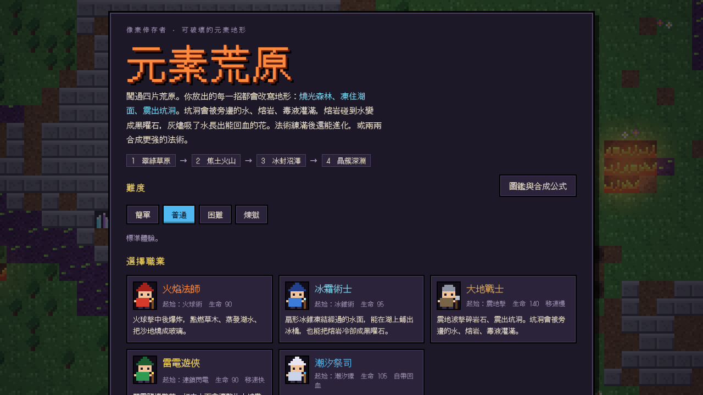

## 目錄

- [遊戲畫面](#遊戲畫面)
- [怎麼玩](#怎麼玩)
- [遊戲內容](#遊戲內容)
- [地形反應系統](#地形反應系統)
- [進化與合成](#進化與合成)
- [程式架構](#程式架構)
- [數值與平衡](#數值與平衡)
- [專案結構](#專案結構)
- [開發工具](#開發工具)

## 遊戲畫面

| 第 1 關：翠綠草原 | 第 2 關：焦土火山 |
|---|---|
| 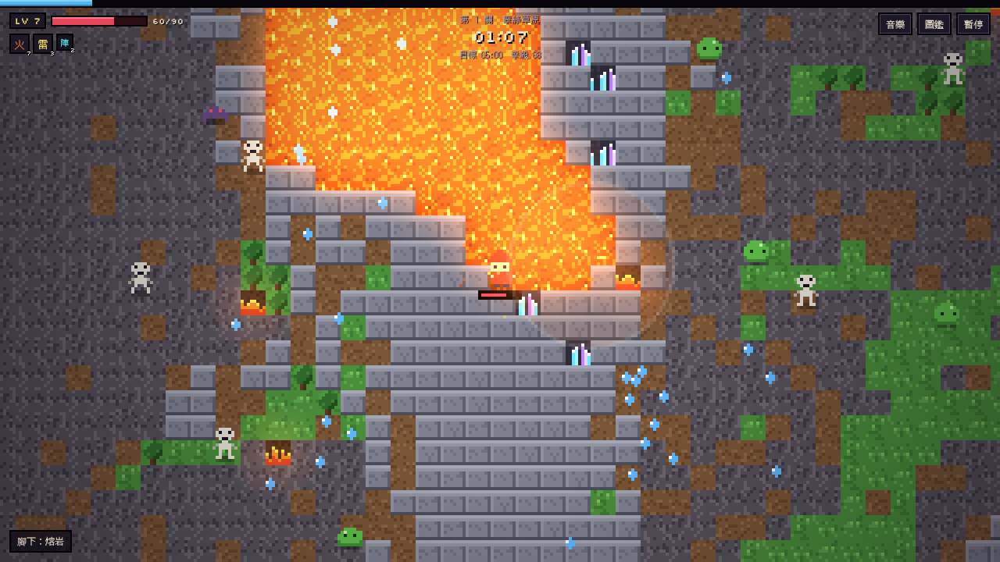 | 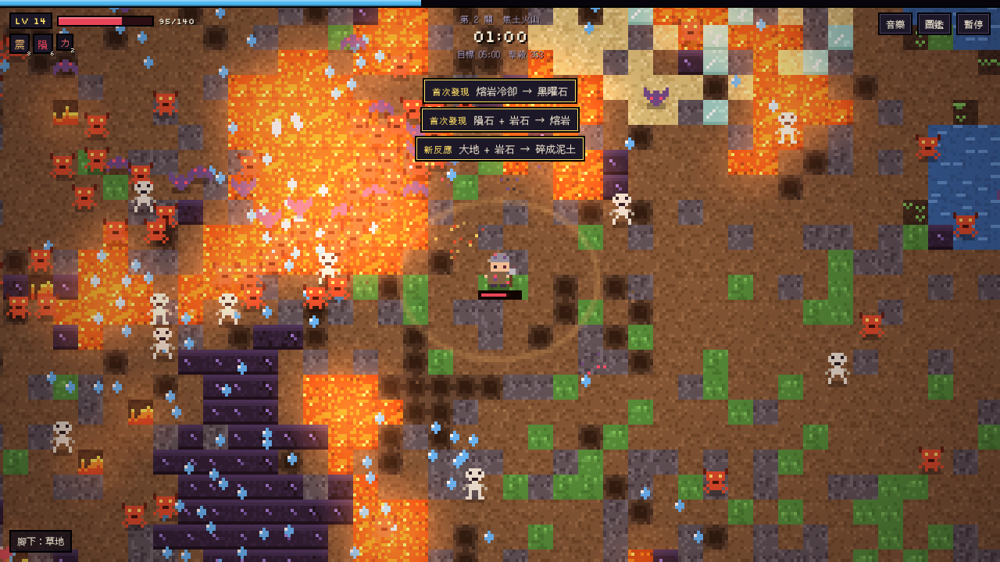 |
| **第 3 關：冰封沼澤** | **第 4 關：晶簇深淵** |
| 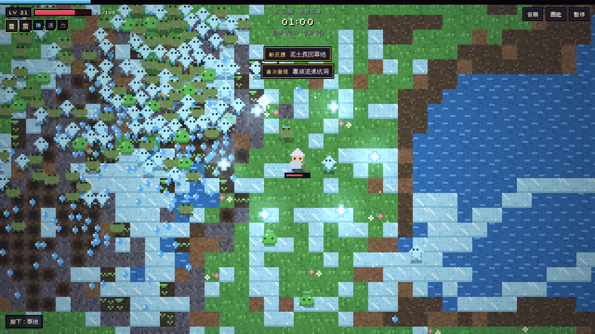 | 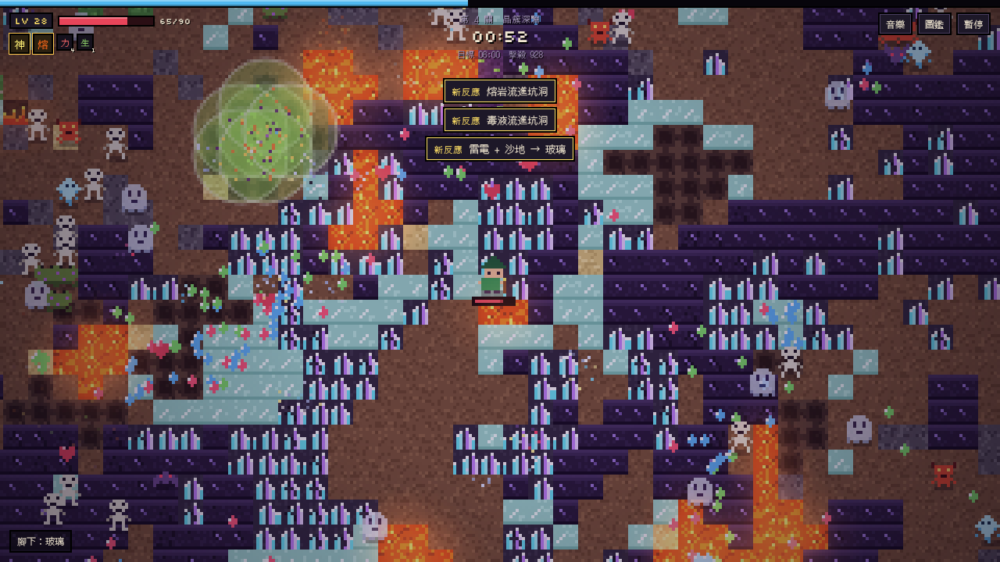 |

| 升級時出現進化選項 | 過關畫面 |
|---|---|
| 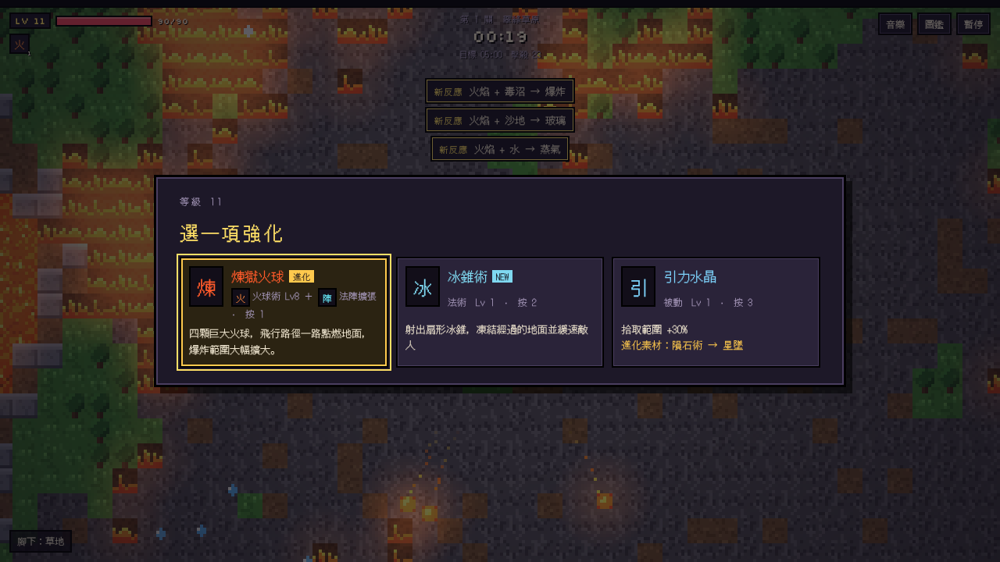 | 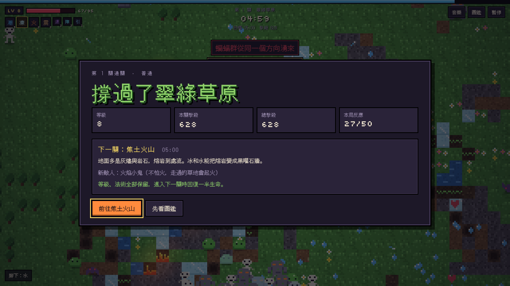 |
| **圖鑑：合成公式與目前進度** | **圖鑑：地形說明** |
| 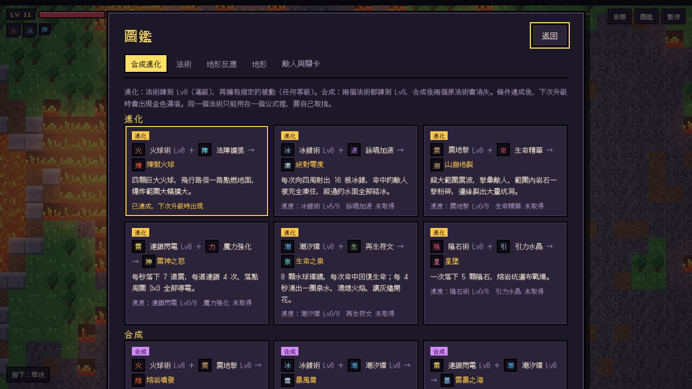 | 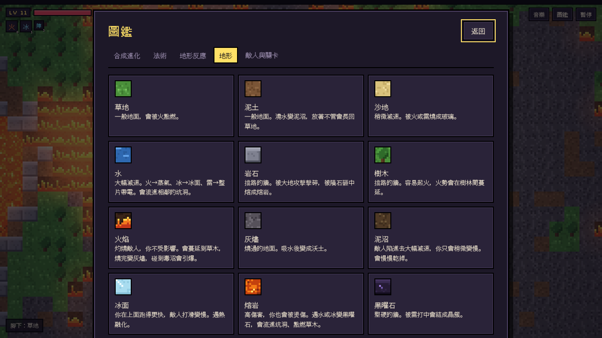 |

<p align="center">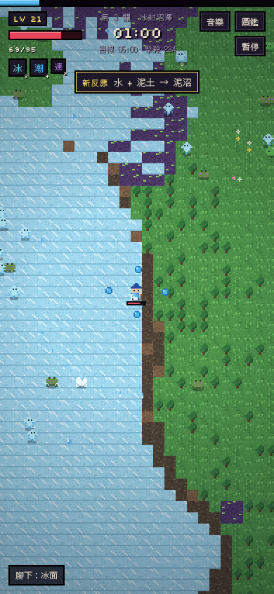<br>手機直式畫面：按住畫面任意處拖曳就是虛擬搖桿</p>

## 怎麼玩

| 操作 | 電腦 | 手機 |
|---|---|---|
| 移動 | `WASD` 或方向鍵 | 按住畫面任意處拖曳 |
| 攻擊 | 自動施放 | 自動施放 |
| 暫停 | `Esc` / `Space` / `P` | 右上角「暫停」 |
| 升級選擇 | 點選，或按 `1` `2` `3` | 點選 |

1. 在主選單選難度和職業。
2. 打倒敵人會掉落經驗寶石，撿起來就會升級。每次升級從三張卡裡選一張：新法術、法術升級、被動，或進化／合成。
3. 撐到關卡時間結束就過關。等級和法術會帶到下一關，進關時回復一半生命。
4. 撐過四個關卡就全破。

想在網路上分享遊玩網址：到 repo 的 **Settings → Pages**，來源選 `main` 分支的根目錄。

## 遊戲內容

### 職業

| 職業 | 起始法術 | 生命 | 特色 |
|---|---|---|---|
| 火焰法師 | 火球術 | 90 | 火球爆炸點燃草木、蒸發湖水、把沙燒成玻璃 |
| 冰霜術士 | 冰錐術 | 95 | 扇形冰錐凍結水面，能鋪出冰橋，也能讓熔岩冷卻 |
| 大地戰士 | 震地擊 | 140 | 擊碎岩石、震出坑洞；移動稍慢 |
| 雷電遊俠 | 連鎖閃電 | 90 | 讓整片水域帶電；移動較快 |
| 潮汐祭司 | 潮汐環 | 105 | 水球環繞、自帶回血；灰燼澆水會開出回血的花 |

### 關卡

| 關卡 | 時間 | 地形 | 新敵人 |
|---|---|---|---|
| 1. 翠綠草原 | 5:00 | 草地、森林、湖泊、少量毒沼 | 史萊姆、蝙蝠、骷髏、幽魂、石像魔 |
| 2. 焦土火山 | 5:00 | 灰燼、岩石、大量熔岩 | 火焰小鬼：不怕火，走過的草地會起火 |
| 3. 冰封沼澤 | 5:00 | 冰湖、泥沼、毒沼 | 冰魄：走過的水會結冰；毒蟾：死後留下毒沼 |
| 4. 晶簇深淵 | 6:00 | 黑曜石、晶簇、地底水池 | 所有敵人一起出現 |

每關在 2:30 和結束前 1 分鐘各出現一次巨像。打倒巨像可以額外升級一次，並回復一半生命。

### 難度

| 難度 | 敵人血量 | 敵人傷害 | 敵人數量 | 經驗值 | 巨像 |
|---|---|---|---|---|---|
| 簡單 | ×0.7 | ×0.6 | ×0.75 | ×1.25 | 1 隻 |
| 普通 | ×1 | ×1 | ×1 | ×1 | 1 隻 |
| 困難 | ×1.45 | ×1.4 | ×1.3 | ×1 | 1 隻 |
| 煉獄 | ×2.1 | ×1.8 | ×1.6 | ×0.9 | 2 隻 |

### 音樂與音效

所有聲音都在瀏覽器裡用 Web Audio 即時合成，沒有任何音檔。主選單和四個關卡各有一首 8-bit 風格的曲子，旋律由固定的亂數種子產生。巨像出現或畫面上敵人很多時，鼓點會變密。主選單和暫停畫面可以分別開關音樂和音效。

## 地形反應系統

地形有 20 種，反應有 50 種。轉化分兩個來源：

- **元素攻擊**：每個法術都帶有一種元素（火、冰、大地、雷、水），打到哪裡就對那一格套用元素。
- **細胞自動機**：每 0.2 秒掃描畫面附近的格子，鄰近的地形會互相影響。例如火會蔓延、水會流進坑洞、熔岩冷卻。

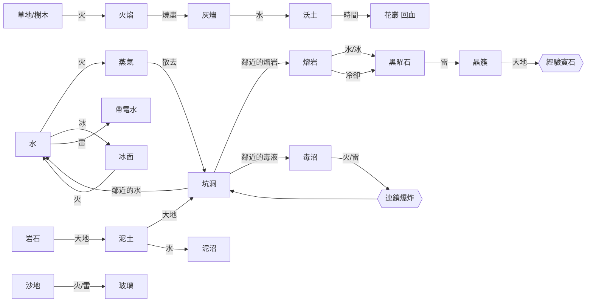

地形也會影響戰鬥：

| 地形 | 對你 | 對敵人 |
|---|---|---|
| 火焰、蒸氣、帶電水 | 無影響 | 持續傷害 |
| 熔岩 | 持續傷害 | 高傷害 |
| 毒沼 | 輕微傷害、減速 | 傷害、減速 |
| 水、泥沼、坑洞 | 稍微減速 | 大幅減速 |
| 冰面、玻璃 | 移動加速 | 冰面上會打滑減速 |
| 花叢 | 每秒回復 4 點生命 | 無 |
| 岩石、樹木、黑曜石、晶簇 | 擋路 | 擋路（石像魔和巨像會撞碎） |

第一次觸發某種反應會跳出提示，並記錄在圖鑑裡。這份紀錄存在瀏覽器裡，下次遊玩還會保留。

## 進化與合成

法術最高 Lv8，被動最高 Lv5。

- **進化**：法術 Lv8，加上擁有指定的被動（任何等級）。
- **合成**：兩個法術都 Lv8，合成後兩個原法術會消失。

條件達成後，下次升級會出現金色選項。同一個法術只能用在一個公式裡，要自己取捨走哪條路線。

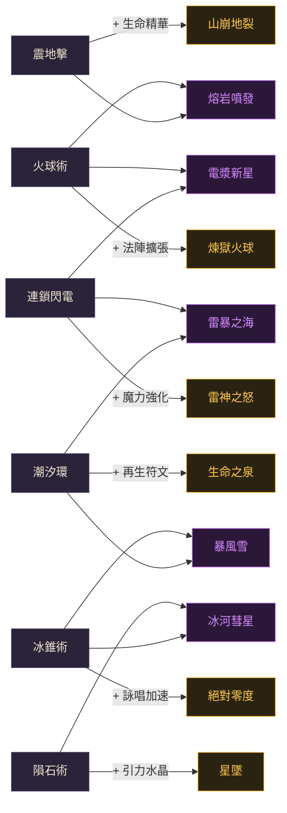

| 類型 | 公式 | 結果 | 效果 |
|---|---|---|---|
| 進化 | 火球術 Lv8 + 法陣擴張 | 煉獄火球 | 四顆巨大火球，飛行路徑一路點燃地面 |
| 進化 | 冰錐術 Lv8 + 詠唱加速 | 絕對零度 | 向四周射出 16 根冰錐，命中的敵人被凍住 |
| 進化 | 震地擊 Lv8 + 生命精華 | 山崩地裂 | 超大範圍震波，擊暈敵人、岩石一擊粉碎 |
| 進化 | 連鎖閃電 Lv8 + 魔力強化 | 雷神之怒 | 每秒 7 道雷、連鎖 4 次，落點 3×3 導電 |
| 進化 | 潮汐環 Lv8 + 再生符文 | 生命之泉 | 8 顆水球命中時回血，每 4 秒湧出泉水 |
| 進化 | 隕石術 Lv8 + 引力水晶 | 星墜 | 一次落下 5 顆隕石 |
| 合成 | 火球術 + 震地擊 | 熔岩噴發 | 敵人腳下噴發熔岩柱，留下熔岩池 |
| 合成 | 冰錐術 + 潮汐環 | 暴風雪 | 冰晶環繞凍結敵人，周圍持續緩速並冰封地面 |
| 合成 | 連鎖閃電 + 潮汐環 | 雷暴之海 | 帶電水球不斷電擊附近敵人 |
| 合成 | 火球術 + 連鎖閃電 | 電漿新星 | 環狀電漿燒灼地面，並引雷劈向敵人 |
| 合成 | 隕石術 + 冰錐術 | 冰河彗星 | 彗星砸出坑洞後立刻冰封，凍住爆心敵人 |

## 程式架構

所有程式碼都在 `index.html` 的一個 `<script>` 裡，用 IIFE 包起來，依功能分成以 `// ---------- 名稱 ----------` 標示的區塊。

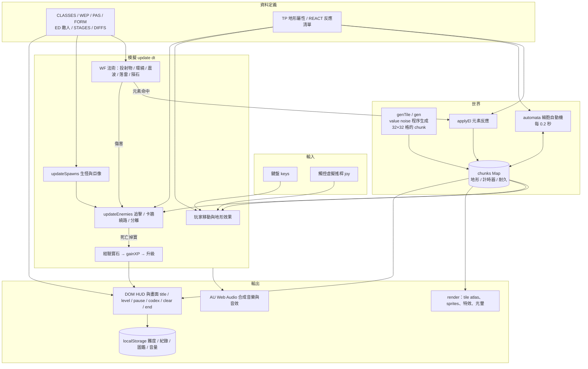

### 主迴圈與遊戲狀態

`requestAnimationFrame` 驅動 `frame()`，每幀的 `dt` 上限是 0.05 秒。只有 `play` 狀態會推進模擬；`title` 狀態只跑背景展示（隨機元素打在地圖上）。

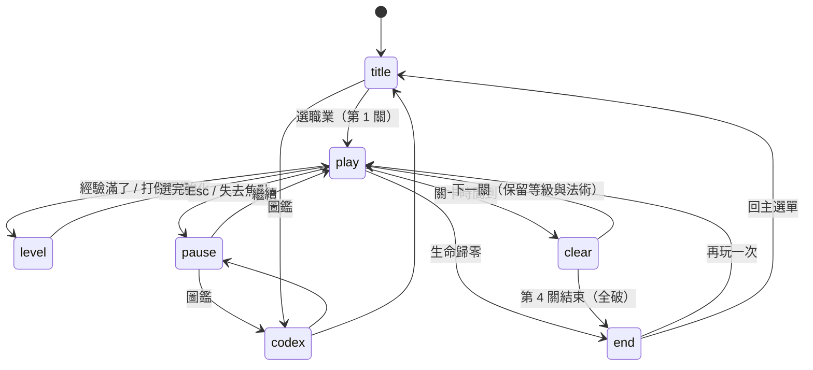

### 程式碼地圖

| 區塊 | 主要內容 |
|---|---|
| `noise` | `hash`、`vnoise`、`fbm`，生成地形用的 value noise |
| `tiles` | 地形 ID `T`、屬性 `TP`，以及碰撞與移動 `moveEnt`、`blocked` |
| `difficulty & stages` | `DIFFS`、`STAGES`，各生態區的 `genTile` |
| `tile atlas` | 把 20 種地形各畫成 3 種變體 × 4 幀動畫，存成一張 atlas |
| `sprites` | 用字串陣列定義的像素角色，執行時轉成 canvas（含翻轉、受擊白閃、冰凍色） |
| `definitions` | 職業、法術、被動、公式、敵人、反應清單 |
| `audio` | `AU`：音序器、曲子定義、旋律產生、音效 |
| `element reactions` | `applyEl`、`electrify`（帶電水擴散）、`boom`（毒沼連鎖爆炸） |
| `cellular automata` | `automata`：火勢蔓延、液體流動、冷卻、開花等 |
| `player / combat` | 玩家、受傷、經驗、`WF` 各法術邏輯、隕石 `impact` |
| `enemies` | 生怪、AI、卡牆繞路、用網格做的分離 |
| `main update` | `update`、`common`（特效、粒子、自動機） |
| `render` | 畫地形、寶石、敵人、玩家、投射物、特效、光暈與色調 |
| `HUD & screens` | HUD、升級卡、暫停、圖鑑、過關、結算 |
| `input` / `loop` | 鍵盤、觸控搖桿、主迴圈 |

### 幾個實作重點

- **無限地圖**：地圖以 32×32 格的 chunk 為單位，第一次碰到時才用 noise 生成。地形、計時器、耐久分別存在 `Uint8Array` 和 `Float32Array` 裡。
- **只模擬看得到的地方**：細胞自動機只掃描鏡頭周圍外加 10 格的範圍，並先收集所有變化再一次套用，避免掃描順序造成偏向。
- **像素渲染**：用低解析度 canvas 繪製，再以整數倍放大（`image-rendering: pixelated`）。倍率依螢幕短邊決定，手機和電腦看到的格子大小差不多。
- **連鎖爆炸**：毒沼被點燃時不會立刻全部爆炸，而是排進 `booms` 佇列並加上短暫延遲，所以看得到爆炸一路傳過去。

## 數值與平衡

| 項目 | 公式 |
|---|---|
| 威脅值 | `thr = 關卡索引 × 200 + 本關秒數` |
| 每秒生怪數 | `(1.1 + thr/22 × min(1, 0.5 + thr/480)) × 難度倍率` |
| 同時存在上限 | `min(240, 40 + thr × 0.45)` |
| 敵人血量倍率 | `(1 + thr/130 + 關卡索引 × 0.46) × 難度倍率` |
| 敵人傷害倍率 | `(1 + thr/520) × 難度倍率`（巨像是 `thr/900`） |
| 升級所需經驗 | 12 級以前 `1.8 × 等級^2.2`，之後每級 `429 + (等級 − 12) × 80` |
| 經驗寶石拾取範圍 | `36 × (1 + 0.3 × 引力水晶等級)` 像素 |

升級曲線是用自動遊玩機器人實測每關能拿到的經驗量後反推的。目標大約是第一關結束 13 級、第二關 21 級、第三關 28 級、全破 35 級。

## 專案結構

```
.
├── index.html              遊戲本體（HTML + CSS + JS，單一檔案）
├── README.md
├── docs/
│   └── screenshots/        README 用的遊戲截圖
└── tools/                  平衡測試與截圖工具（Node.js + Playwright）
    ├── make.sh             產生 game.html：在 index.html 加上測試用的掛鉤 window.__t
    ├── bot.js              自動遊玩機器人
    ├── summ.py             整理 bot.js 的輸出
    └── screenshots.js      重新產生 docs/screenshots 裡的截圖
```

## 開發工具

需要 Node.js 和 Playwright（`npm i playwright` 並安裝 Chromium）。

```sh
cd tools
bash make.sh                                        # 產生 game.html
node bot.js <職業 0-4> <難度 0-3> <局數> | python3 summ.py
node screenshots.js                                 # 更新 README 截圖
```

- **職業編號**：0 火焰法師、1 冰霜術士、2 大地戰士、3 雷電遊俠、4 潮汐祭司。
- **難度編號**：0 簡單、1 普通、2 困難、3 煉獄。

`bot.js` 會閃躲敵人、避開熔岩和毒沼、撿經驗寶石，升級時優先選主法術。它從第一關一路打到第四關，每 30 秒記錄一次等級、血量、敵人數量和法術。倒下時會列出最後 8 秒是被什麼打死的。機器人的操作比真人差，數據適合拿來比較調整前後的差異。
